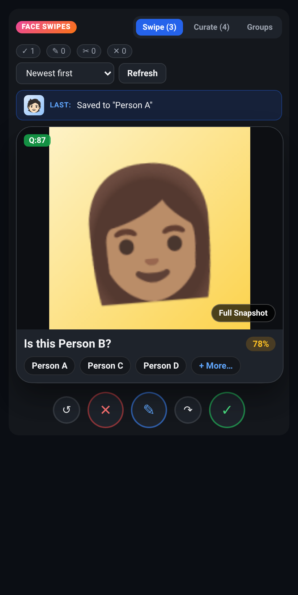
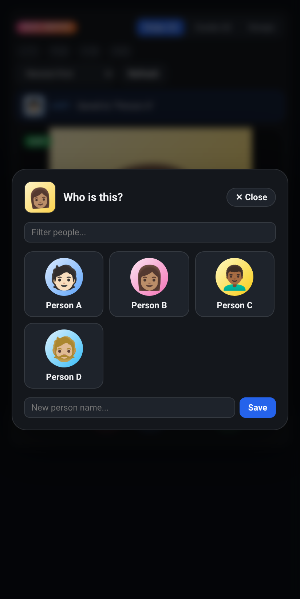
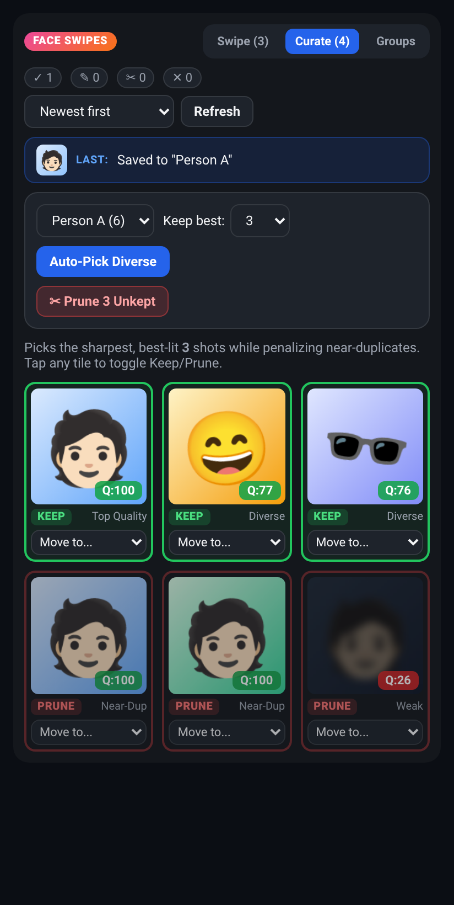

# Frigate Face Swipes (HACS Integration)

A Home Assistant custom integration & Lit/TypeScript Lovelace card/panel for **Tinder-style** and **Google Photos-style** face assignment and curation with **Frigate** (0.16+).

## Screenshots

| Swipe Mode (Assign Names) | Who Is This? Popover | Curate Mode (Best-N Diverse) |
| :---: | :---: | :---: |
|  |  |  |

## Features

- **Swipe Mode (Assign Names):**
  - **Swipe Right (`→`)** to confirm and train the predicted person (`POST /api/faces/train/:name/classify`).
  - **Swipe Left (`←`)** to trash blurry, dark, or non-face crops (`POST /api/faces/train/delete`).
  - **Quick-Assign Pills & Popover (`↑` / `✎`):** Tap a person pill directly on the card, or open the centered **Who is this?** modal with search and **+ New person** creation.
  - **Swipe Down (`↓`)** to skip, **`Z`** to undo skips.
  - **Full Snapshot Toggle & `Last:` Confirmation Bar:** Preview the full bounding-box snapshot when needed, and see a thumbnail of your last action in the confirmation bar.
  - **Phone-Optimized:** Fits cleanly on mobile screens without scrolling.
- **Curate Mode (Best `N` with Diversity):**
  - Automatically scores every registered face photo (`Q: 0–100`) on resolution, sharpness, and exposure, plus a 16×16 perceptual fingerprint.
  - **Auto-Pick Diverse** selects the sharpest, best-lit `N` shots (`3`–`20`) while penalizing near-duplicate frames (`Top Quality`, `Diverse`, `Near-Dup`, `Weak`).
  - Tap any tile to toggle **Keep** / **Prune**, move misclassified photos to another person, and **✂ Prune Unkept** in one click.
- **Groups Mode:** View pending faces grouped by predicted person / unknown visitors and batch-save or batch-trash selected tiles.
- **Zero CORS / Reverse-Proxy Headaches:** Home Assistant's Python backend proxies `/api/faces`, `/api/events`, and `/clips/faces` securely using HA authentication.
- **Auto-Registered UI:** Adds a **Face Swipes** sidebar panel and registers `custom:frigate-face-swipes-card` automatically.

## Installation via HACS

1. In Home Assistant, open **HACS → ⋮ → Custom repositories**.
2. Add `https://github.com/reedlabotz/frigate-face-swipes` with category **Integration**.
3. Install **Frigate Face Swipes** and restart Home Assistant.
4. Go to **Settings → Devices & Services → Add Integration → Frigate Face Swipes**.
5. Enter your Frigate URL (auto-suggested if the Frigate integration is already installed) and optional credentials.
6. Open **Face Swipes** from your Home Assistant sidebar, or add `type: custom:frigate-face-swipes-card` to any dashboard.

## Development

The frontend is built with **TypeScript**, **Lit**, and **Vite** (`src/` → `custom_components/frigate_face_swipes/frontend/frigate-face-swipes-card.js`):

```bash
npm install
npm run build        # Typecheck (tsc --noEmit) and bundle with Vite
npm run dev          # Watch mode
npm run screenshots  # Regenerate docs/screenshots/*.png using emoji sample faces
```
